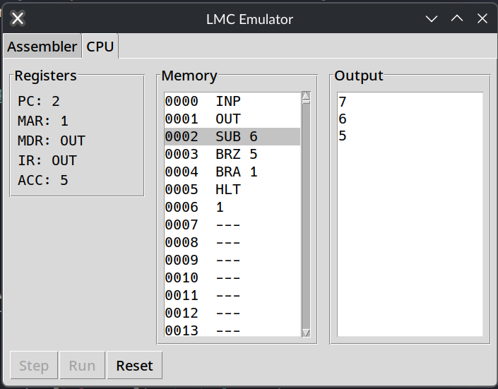

# Python LMC Emulator

A Little Man Computer emulator with a built-in assembler, so you can write a program and watch a simple CPU run it one instruction at a time.

Made for Hack Club Crescent (https://crescent.hackclub.com)

## Description

This is a Little Man Computer emulator written in Python with a Tkinter GUI. It has two tabs: an **Assembler** tab where you write or load LMC assembly, and a **CPU** tab where you run it. As the program runs you can see the registers change, see the memory and see the output appear. You can step through one instruction at a time to see exactly what the FDE cycle is doing or just hit Run and watch it go.

It's a remake of a CPU simulator I originally built in Scratch in one night, based on what I learned in GCSE Computer Science.

### Screenshots



## Getting Started

### Dependencies

* **Using a release build:** nothing extra is needed.
  * Windows 10 or later
  * Linux (64-bit)
  * macOS
* **Running from source:** Python 3 with Tkinter. It only uses the standard library, so there's nothing to install with pip.

### Installing

* Download the build for your OS from the [Releases](../../releases) page:
  * Windows: `python-lmc-emulator-windows.exe`
  * Linux: `python-lmc-emulator-linux`
  * macOS: `python-lmc-emulator-macos.zip` (unzip it first)
* On Linux, make the file executable before running it:
```
chmod +x python-lmc-emulator-linux
```
* To run from source instead, clone the repo:
```
git clone https://github.com/tomTTFB/python-lmc-emulator.git
cd python-lmc-emulator
```

### Executing program

* Open the app (or run it from source):
```
python main.py
```
* On the **Assembler** tab, type a program into the editor, or click **Load from file** to open one from the `examples` folder.
* Click **Push to memory**. This assembles the program, loads it into memory and switches to the CPU tab.
* On the **CPU** tab, click **Step** to run one instruction at a time, or **Run** to run the whole program.
* Click **Reset** to put the program back to how it was when you pushed it and start again.
* **Save to file** on the Assembler tab saves the source version of your program, so it can be loaded and edited later.

#### Instructions

| Instruction | What it does |
|---|---|
| `INP` | Ask for a number and put it in the accumulator |
| `OUT` | Output the value in the accumulator |
| `LDA x` | Load the value at address `x` into the accumulator |
| `STA x` | Store the accumulator at address `x` |
| `ADD x` | Add the value at address `x` to the accumulator |
| `SUB x` | Subtract the value at address `x` from the accumulator |
| `BRA x` | Always jump to address `x` |
| `BRZ x` | Jump to address `x` if the accumulator is zero |
| `BRP x` | Jump to address `x` if the accumulator is zero or positive |
| `HLT` | Stop the program |

You can put a **label** at the start of a line and use it instead of an address. To store a **number** in memory, put it on its own line, optionally with a label.

Comments can be made by using `//` or `;`, they work anywhere on a line

#### Example: countdown

Asks for a number, then counts down to 1:
```
INP // ask for a number
loop OUT
SUB one // subtracts 1
BRZ end // stop when we hit 0
BRA loop
end HLT
one 1
```

There are more examples in the [`examples`](examples) folder.

## Help

* **Windows says it's from an unknown publisher.** The builds aren't signed. Click **More info**, then **Run anyway**.
* **macOS won't open it.** Right-click the app, choose **Open**, then confirm.
* **Instructions need to be in capitals.** Lowercase ones like `out` get read as labels, which can cause confusing errors or lines being skipped.
* **"tried to execute data" error.** The program ran into a data line instead of an instruction. Check there's a `HLT` before your data.

## License

This project is licensed under the MIT License